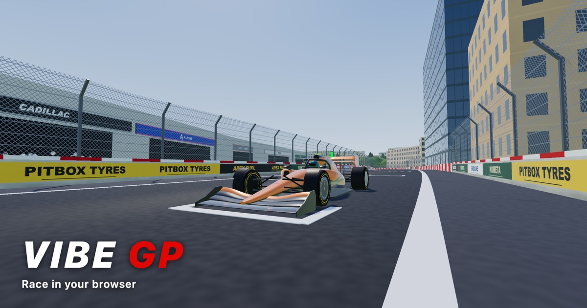

# Vibe GP

[](https://vibe-gp.ben3d.ca)

A small F1-style racing game built with [three.js](https://threejs.org/) using `WebGPURenderer` and node-based (TSL) materials. All track and car geometry is built by hand in code, and all surface detail is procedural (no textures or models).

**Play it at [vibe-gp.ben3d.ca](https://vibe-gp.ben3d.ca).**

## Running

```sh
pnpm install
pnpm dev
```

Then open http://localhost:5173 and pick a circuit: the Test Oval, every circuit on the 2026 Formula 1 calendar, and Imola. A browser with WebGPU support is recommended; three.js falls back to WebGL2 otherwise.

## Circuits

Every real circuit is built from OpenStreetMap's centreline and pit lane, with its real height profile:

| | |
| --- | --- |
| 2026 calendar | Albert Park, Shanghai, Suzuka, Bahrain*, Jeddah*, Miami, Montreal, Monaco, Barcelona-Catalunya, Red Bull Ring, Silverstone, Spa-Francorchamps, Hungaroring, Zandvoort, Monza, Madring, Baku, Marina Bay, Circuit of the Americas, Hermanos Rodriguez, Interlagos, Las Vegas, Lusail, Yas Marina |
| Also | Imola (last raced in 2025) |

\* On the published 2026 calendar, but cancelled in March 2026.

Suzuka's figure of eight crosses over itself: the back straight runs over the section after Degner on a bridge. Sections more than 4 m apart in height don't squeeze each other's walls or collide with each other's barriers, and a concrete deck carries the upper road.

## Controls

| Key | Action |
| --- | --- |
| W / ↑ | Throttle |
| S / ↓ | Brake / reverse |
| A D / ← → | Steer |
| C | Cycle camera (chase, far, T-cam, driver, TV); the side mirrors work in every view |
| F | Change the front wing at the next pit stop (on / off; also on the HUD) |
| R | Reset to the grid |
| Esc | Back to the track selector |

On a phone or tablet the game shows touch controls (steering pad, gas, brake, menu, camera, reset); phones play in landscape. Tyre and front wing choices are keyboard or desktop HUD only.

Touch devices also get a lighter scene (`src/quality.js`): no crowd, half the trees and no mirror views. Add `?quality=full` or `?quality=mobile` to the URL to force either one.

The gear in the top-right corner opens **Settings**: traction control (traction, stability & steering assists), ABS, damage on / off (off also repairs the car), music and sound effects. Settings are saved between sessions.

## Project layout

- `src/geometry.js`: hand-built geometry helpers (rings, walls, boxes, lofts, tubes, wheels)
- `src/materials.js`: TSL node materials and the sky
- `src/tracks/*.js`: track definitions (centreline control points in metres, start line first, in racing direction); most are generated by `scripts/import-track.mjs`
- `scripts/circuits.mjs`: the real circuits' import settings (OSM relation, official length, direction, kerb colours, scenery, elevation source and calibration)
- `src/trackPath.js`: centreline sampling, kerbs, wall clearance and nearest-point queries
- `src/track.js`: builds the road, kerbs, walls, gantry and grid for any track definition
- `src/barriers.js`: concrete walls with sponsor boards, tyre barriers (conveyor-belt facing) on the outside of corners, and leaning catch fences
- `src/grandstands.js`: picks grandstand sites (opposite the pits and around the tightest corners, clear of the circuit) and builds stepped, roofed stands with an instanced, animated crowd
- `src/night.js`: night races (`night` in a track definition): floodlight towers with lamp halos, a floodlit-area mask that leaves the land beyond the circuit dark, and a pool of point lights that follows the camera between the nearest towers
- `src/ads.js`: the canvas atlas of made-up trackside sponsor boards
- `src/car.js`: the car model (current-era F1 shape: multi-element wings, downwash sidepods, sculpted floor, working mirrors)
- `src/carGeometry.js`: car-specific geometry builders (ring lofts, airfoils, extruded plates, slick tyres)
- `src/teams.js`: the full 2026 grid (11 teams, ordered by the 2025 constructors' standings, which is also the garage order): liveries in procedural TSL paint, race numbers and sponsor layouts
- `src/logos.js`: hand-drawn vector stand-ins for the team and sponsor logos (brand colours or single-colour ink)
- `src/decals.js`: packs each body part's logos into one canvas atlas and projects them onto the bodywork (side, rear and top-down)
- `src/physics.js`: four-wheel vehicle model (aero, load transfer, wheel spin, assists) and tuning parameters
- `src/tyres.js`: tyre model and surface table (asphalt, kerb, grass)
- `src/damage.js`: collision damage to every part of the car (wings, floor, sidepods, mirrors, suspension, tyres, engine)
- `src/camera.js`, `src/race.js`, `src/hud.js`, `src/input.js`: cameras, lap timing, HUD, keyboard input

## Adding a track

After adding or changing a track, run `pnpm cards` to regenerate its menu card (`src/tracks/cards.js`).

Real circuits: add an entry to `scripts/circuits.mjs`, register the id in `src/tracks/index.js`, then

```sh
node scripts/import-track.mjs <id>     # centreline, pit lane, start line and corner names from OpenStreetMap
node scripts/fetch-elevation.mjs <id>  # real height profile (DEM or LiDAR), calibrated to published figures
```

The importer joins the circuit's raceway ways (and, for street circuits, its OSM relation's roads) into a graph and takes the lap as the cycle closest to the official length; `via` / `avoid` points pick between layouts of similar length. Direction comes from the raceway ways' oneway tags, the start line from the `raceway=finish` node where mapped. A track's `scenery` sets tree cover, conifers, palms, desert or dune ground, and city blocks around street circuits.

Made-up tracks: create `src/tracks/<id>.js` (see `oval.js` for the format) and register it in `src/tracks/index.js`.

Then check it:

```sh
node scripts/track-check.mjs <id>
```

This prints the lap length, the tightest corner, any sections that are too close together, and an autopilot lap time. It also writes an SVG map to `track-check/<id>.svg`.

A track can have a pit lane: add `pitlane: { points: [...] }` with the lane's centreline in the same map coordinates, in the driving direction, from where it leaves the track to where it rejoins. The real circuits use the pit lane ways from OpenStreetMap, registered onto the track's centreline. The game builds the pit wall, merges, outer wall, garages and the 80 km/h speed-limit zone from that line. `track-check` then drives a lap through the lane and reports the drive-through time loss, and also writes `track-check/<id>-pit.svg`.

Each team has its own garage and pit box, in `TEAMS` order from the pit entry (`teamGarage` in `src/teams.js`); spare garages have their shutters down. The box is painted on the working lane in team colours with a stop line for the front axle (`src/pitBoxes.js`). Pull into your team's box and stop on the marks: the crew holds the car and fits fresh tyres, and the stop takes longer the further you are off the marks (`src/pitStop.js`). The HUD counts down the distance to your box, and the minimap marks it. `track-check` also drives into every team's box, stops there and drives out.

## Damage

Hitting a wall can damage every part of the car except the survival cell (monocoque and halo) (`src/damage.js`). Press **B** to switch damage off and on; switching it off also repairs the car.

Each part is described by its outermost points. The wall touches whichever point sticks out furthest towards it, and the hit then crushes into the car further the faster it was going into the wall. Every part within that depth is damaged, the parts nearest the first contact most. So a head-on hit breaks the front wing, and a harder one also reaches the front wheels. A side swipe catches the wing endplate, both wheels and the floor edge on that side; only a heavy one crushes the sidepod or takes off a mirror. Reversing into a wall breaks the rear wing, then the gearbox. Very hard hits anywhere also shake the engine. Gentle scrapes do no damage.

| Part | What it does to the car | What you see |
| --- | --- | --- |
| Front wing (each half) | Loses that side's front downforce: understeer, and the car handles differently in left and right corners | Bends back, loses its endplate, then breaks off |
| Rear wing | Loses rear downforce (oversteer) but also drag | Folds back and twists, then snaps off |
| Floor (each side) | Loses downforce on both axles | The floor-edge wing tears off |
| Sidepods | Adds drag; a crushed radiator overheats the engine and costs power | Crumple inwards |
| Mirrors | — | Knocked off; that mirror's view is gone |
| Suspension (each corner) | The wheel toes out (the car pulls to that side), loses grip from the wrong camber, and drags | The wheel leans and toes out, and sags |
| Tyres (each corner) | Less grip and more rolling resistance | Red bar on the tyre's HUD box |
| Engine / gearbox | Loses up to half its power | Smoke, from grey wisps to thick black |

The damage diagram beside the dash shows the whole car from above, each part coloured from green to red, dashed where it has broken off. A warning flashes for the worst thing each hit breaks. Broken-off parts fly away and stay on the track until you reset.

In the pits, every stop fits new tyres, which clears tyre damage on all four corners. To get a new front wing, press **F** (or click *New front wing* on the HUD) any time before the stop. While it's on, two wing crew wait in the garage holding the spare. In the box, two crew pull the old wing off and carry it into the garage, and two more fit the new one while the tyres are changed. That takes the stop to about 7.5 s, against about 2.2 s for tyres only. The choice is reset after the stop. Nothing else can be fixed in a pit stop: reset (**R**) for a fresh car. `track-check` turns damage off for its autopilot lap.

## Driving physics

Grip comes from a tyre model rather than fixed grip numbers, so each of the four tyres can be on a different surface.

- **Tyre forces**: a Pacejka "Magic Formula" curve on combined slip (slip angle and slip ratio share one friction ellipse). Slicks peak at about 5° slip angle and 10% slip ratio, then fall away into a slide.
- **Balance**: the rear tyres are wider (405 mm vs 305 mm), so they get 5% more grip, which keeps the rear stable.
- **Load sensitivity**: peak force grows with vertical load to the power 0.85, so the friction coefficient drops as downforce and load transfer pile on. Weight shifting onto the outside tyres costs total grip.
- **Aero and load transfer**: downforce and drag grow with v² (ClA 7.5, about 3.8× the car's weight at 300 km/h; that's more than a real F1 car, chosen for grip; CdA 1.27). Each wheel's load includes weight, downforce split by aero balance, and longitudinal and lateral load transfer.
- **Wheel spin**: each wheel's spin is integrated against drive, brake and tyre torque, so wheelspin happens on its own. Traction control caps drive torque at what the rear tyres can take (on by default, since keyboard input is on/off). The brakes are always anti-lock: brake pressure is capped at each tyre's grip, a wheel can never slow past peak-grip slip, and while you steer about 30% of the front tyres' grip is held back for turning, so the car turns under braking. Steering assist, on the T key, aims the front tyres at their peak-grip slip angle relative to where the front axle is travelling, so full lock on the keyboard always gives the tightest turn the tyres allow without scrubbing. Stability control, on the same key as traction control, countersteers toward the direction of travel and trims the throttle once the car slides more than about 4°, so quick corrections and rejoining from the grass don't spin the car.
- **Tyre temperature**: tread temperature rises with sliding and carcass flex and falls with airflow. Grip peaks at 105 °C with about 1% loss at 100 °C and 115 °C (Pirelli's stated window). Tyres start at the 70 °C blanket temperature. The HUD shows each tyre's temperature, outlined white when sliding, red on a kerb and green on grass.

| Surface | μ | Other effects |
| --- | --- | --- |
| Asphalt | 1.8 | none |
| Kerb | 1.6 (non-slip paint) | ridges make the tyre load fluctuate; the floor loses ~20% downforce per wheel on the kerb |
| Grass | 0.55 | flat slip curve (sliding is about as good as gripping), extra rolling resistance, ~20% downforce loss, picks up dirt that costs up to 8% grip until it scrubs off on asphalt |

Measured in the model: about 2 g in slow corners, about 4.5 g at 230 km/h, 0–100 km/h in 2.5 s, 300–0 km/h in 85 m (peak deceleration about 7 g), and a 324 km/h top speed. Grip and braking are tuned above real F1 figures (about 5 g peak cornering, 300–0 km/h in about 4 s) to make the car more responsive.

## Credits

- Circuit centrelines, pit lanes and surrounding land: © [OpenStreetMap](https://www.openstreetmap.org/copyright) contributors, available under the [Open Database License](https://opendatacommons.org/licenses/odbl/).
- Circuit elevation: Mapzen terrain tiles, EU-DEM 25 m and USGS 3DEP / NED 10 m, looked up through the [OpenTopoData](https://www.opentopodata.org) API; Environment Agency LiDAR Composite DTM 1 m (© Environment Agency); NRCan HRDEM Mosaic DTM (Open Government Licence - Canada).
- Rendering: [three.js](https://threejs.org/).

## Disclaimer

Vibe GP is an unofficial, non-commercial fan project. It is not affiliated with, endorsed by, sponsored by or otherwise connected to Formula 1, the FIA, or any team, driver, car maker, sponsor, circuit or other brand mentioned in this project or shown in the game. All names and trademarks belong to their respective owners and are used only to identify them. Team and sponsor logos in the game are hand-drawn stand-ins, not official artwork.
