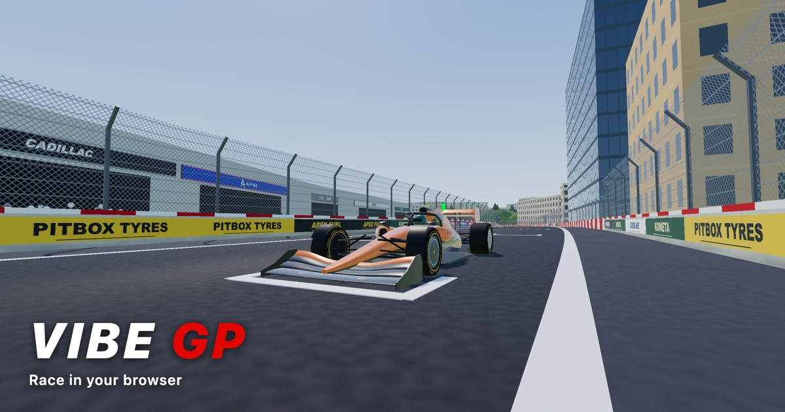

# Vibe GP

[](https://vibe-gp.ben3d.ca)

A small F1-style racing game built with [three.js](https://threejs.org/) using `WebGPURenderer` and node-based (TSL) materials. All track and car geometry is built by hand in code, and all surface detail is procedural (no textures or models).

**Play it at [vibe-gp.ben3d.ca](https://vibe-gp.ben3d.ca).**

## Running

```sh
pnpm install
pnpm dev
```

Then open http://localhost:5173 and pick a circuit: the Test Oval, every circuit on the 2026 Formula 1 calendar, and Imola. A browser with WebGPU support is recommended; three.js falls back to WebGL2 otherwise.

## Circuits

Every real circuit is built from OpenStreetMap's centreline and pit lane, with its real height profile:

| | |
| --- | --- |
| 2026 calendar | Albert Park, Shanghai, Suzuka, Bahrain*, Jeddah*, Miami, Montreal, Monaco, Barcelona-Catalunya, Red Bull Ring, Silverstone, Spa-Francorchamps, Hungaroring, Zandvoort, Monza, Madring, Baku, Marina Bay, Circuit of the Americas, Hermanos Rodriguez, Interlagos, Las Vegas, Lusail, Yas Marina |
| Also | Imola (last raced in 2025) |

\* On the published 2026 calendar, but cancelled in March 2026.

Suzuka's figure of eight crosses over itself: the back straight runs over the section after Degner on a bridge. Sections more than 4 m apart in height don't squeeze each other's walls or collide with each other's barriers, and a concrete deck carries the upper road.

## Controls

| Key | Action |
| --- | --- |
| W / ↑ | Throttle |
| S / ↓ | Brake / reverse |
| A D / ← → | Steer |
| V | Free camera, flying like creative mode in Minecraft: WASD move across the ground in the direction you face (looking up or down doesn't make it climb or dive), Space (or E) up, Shift (or Q) down, double-tap W to sprint, arrows or a mouse drag to look around, the mouse wheel for a slower or faster flying speed. While it's on, your car drives itself on the AI's line. V or C goes back |
| Click a car in the timing tower (in free cam) | Watch that car: the camera views (C) ride on it, including its driver view with its own steering wheel and dash, and the HUD and engine sound follow it. [ and ] step to the car ahead or behind; clicking YOU or pressing V goes back |
| B (free cam) | Replay the last crash or spin in the incident monitor. In free cam a monitor pops up whenever a car crashes, spins, makes contact or goes into the gravel, with a camera near that car. Once it has sorted itself out the monitor rewinds and replays the incident in slow motion from a couple of seconds before. A retirement replays the crash that caused it. Click the monitor to watch that car |
| M | Director mode: the game's view becomes a broadcast director's monitor wall. The main view follows one car (the leader to start with, and your own car drives itself), with the camera views (C) and G to take its wheel as when watching. Down the left is a column of small onboard monitors, one per car in race order, from the camera on its airbox, with position and speed (or PIT / OUT). The running order (the timing tower) moves to the right under the minimap, and the highlights (the incident monitor's crashes, spins and replays) sit in the bottom right corner. A label at the top names the car in the main view. Click a monitor, the highlight or a name in the tower to put that car in the main view. The small monitors take turns, two redrawn a frame. M again goes back to your car
| G (watching a car) | Take the wheel of the car you're watching: you drive it with your own assists while your car drives itself. 1-3 and F set its next pit stop, R puts it back on the track, and G hands it back to its AI driver, which carries on from where you left it |
| C | Cycle camera (chase, far, T-cam, driver, TV); the side mirrors work in every view. The driver view sits at the driver's eyes, behind the halo's slim centre pillar, over a steering wheel that turns with the car and has shift lights and a dash (speed, gear, position, lap, assists and tyre life) |
| F | Change the front wing at the next pit stop (on / off; also on the HUD) |
| O | Show the cars' collision boxes (debug): solid parts cyan, wings orange, wheels yellow; a box that touches another car flashes red. Also in Settings → Display → Debug, for touch screens; off each time the game loads |
| R | Restart the race from the grid |
| Esc / P | Pause menu: resume, restart the race, settings, or change car or circuit. The race also pauses when the window loses focus |

On a phone or tablet the game shows touch controls (steering pad, gas, brake, menu, camera, reset); phones play in landscape. Tyre and front wing choices are keyboard or desktop HUD only.

Touch devices also get a lighter scene (`src/quality.js`): no crowd, half the trees, no mirror views, smaller shadows and lighter sponsor decal textures. Settings > **Graphics** picks it on any device:
- *Auto* (the default): the full scene, with the render resolution stepped down while the frame rate stays under about 48 fps, and back up once it's steady (stepping back up waits longer each time a step up doesn't hold).
- *High*: the full scene at the screen's own resolution (up to 2×), never lowered.
- *Low*: the light scene at 1× resolution, still adapting, with the full grid of AI cars on a desktop. On Suzuka with a full grid it draws about 1.7 million triangles a frame instead of 5.9 million.

Changing it reloads the game. Add `?quality=full` or `?quality=mobile` to the URL to force either scene.

The gear in the top-right corner opens **Settings**: traction control (traction, stability & steering assists), ABS, damage on / off (off also repairs the car), music and sound effects. Settings are saved between sessions.

## Project layout

- `src/geometry.js`: hand-built geometry helpers (rings, walls, boxes, lofts, tubes, wheels)
- `src/materials.js`: TSL node materials and the sky
- `src/tracks/*.js`: track definitions (centreline control points in metres, start line first, in racing direction); most are generated by `scripts/import-track.mjs`
- `scripts/circuits.mjs`: the real circuits' import settings (OSM relation, official length, direction, kerb colours, scenery, elevation source and calibration)
- `src/trackPath.js`: centreline sampling, kerbs, wall clearance and nearest-point queries
- `src/track.js`: builds the road, kerbs, walls, gantry and grid for any track definition
- `src/barriers.js`: concrete walls with sponsor boards, tyre barriers (conveyor-belt facing) on the outside of corners, and leaning catch fences
- `src/grandstands.js`: picks grandstand sites (opposite the pits and around the tightest corners, clear of the circuit) and builds stepped, roofed stands with an instanced, animated crowd
- `src/night.js`: night races (`night` in a track definition): floodlight towers with lamp halos, a floodlit-area mask that leaves the land beyond the circuit dark, and a pool of point lights that follows the camera between the nearest towers
- `src/ads.js`: the canvas atlas of made-up trackside sponsor boards
- `src/car.js`: the car model (current-era F1 shape: multi-element wings, downwash sidepods, sculpted floor, working mirrors)
- `src/freecam.js`: the free camera (V)
- `src/director.js`: director mode (M): every car's onboard monitor down the left of the view, with the main view and the highlights
- `src/incidents.js`: the incident monitor in free cam: spotting crashes and spins, the picture-in-picture view and replays from the last 60 s of recorded car poses
- `src/wheel.js`: the player's steering wheel for the driver view: buttons, rotaries, shift lights and a canvas dash display
- `src/carGeometry.js`: car-specific geometry builders (ring lofts, airfoils, extruded plates, slick tyres)
- `src/teams.js`: the full 2026 grid (11 teams, ordered by the 2025 constructors' standings, which is also the garage order): liveries in procedural TSL paint, race numbers and sponsor layouts
- `src/logos.js`: hand-drawn vector stand-ins for the team and sponsor logos (brand colours or single-colour ink)
- `src/decals.js`: packs each body part's logos into one canvas atlas and projects them onto the bodywork (side, rear and top-down)
- `src/physics.js`: four-wheel vehicle model (aero, load transfer, wheel spin, assists) and tuning parameters
- `src/tyres.js`: tyre model and surface table (asphalt, kerb, grass)
- `src/damage.js`: collision damage to every part of the car (wings, floor, sidepods, mirrors, suspension, tyres, engine)
- `src/camera.js`, `src/race.js`, `src/hud.js`, `src/input.js`: cameras, lap timing, HUD, keyboard input

## Adding a track

After adding or changing a track, run `pnpm cards` to regenerate its menu card (`src/tracks/cards.js`).

Real circuits: add an entry to `scripts/circuits.mjs`, register the id in `src/tracks/index.js`, then

```sh
node scripts/import-track.mjs <id>     # centreline, pit lane, start line and corner names from OpenStreetMap
node scripts/fetch-elevation.mjs <id>  # real height profile (DEM or LiDAR), calibrated to published figures
```

The importer joins the circuit's raceway ways (and, for street circuits, its OSM relation's roads) into a graph and takes the lap as the cycle closest to the official length; `via` / `avoid` points pick between layouts of similar length. Direction comes from the raceway ways' oneway tags, the start line from the `raceway=finish` node where mapped. A track's `scenery` sets tree cover, conifers, palms, desert or dune ground, and city blocks around street circuits.

Made-up tracks: create `src/tracks/<id>.js` (see `oval.js` for the format) and register it in `src/tracks/index.js`.

Then check it:

```sh
node scripts/track-check.mjs <id>
```

This prints the lap length, the tightest corner, any sections that are too close together, and an autopilot lap time. It also writes an SVG map to `track-check/<id>.svg`.

A track can have a pit lane: add `pitlane: { points: [...] }` with the lane's centreline in the same map coordinates, in the driving direction, from where it leaves the track to where it rejoins. The real circuits use the pit lane ways from OpenStreetMap, registered onto the track's centreline. The game builds the pit wall, merges, outer wall, garages and the 80 km/h speed-limit zone from that line. Where the real lane runs well away from the track (Monaco's sits midway between the start straight and the Swimming Pool), `hug: true` (`pitHug` in `scripts/circuits.mjs`) rebuilds it alongside the track, a pit wall's width off, keeping the real entry and exit, so the garages behind it stay clear of the other road. `track-check` reports a garage block that stands on any part of the track. `track-check` then drives a lap through the lane and reports the drive-through time loss, and also writes `track-check/<id>-pit.svg`.

Each team has its own garage and pit box, in `TEAMS` order from the pit entry (`teamGarage` in `src/teams.js`); spare garages have their shutters down. The box is painted on the working lane in team colours with a stop line for the front axle (`src/pitBoxes.js`). Pull into your team's box and stop on the marks: the crew holds the car and fits fresh tyres, and the stop takes longer the further you are off the marks (`src/pitStop.js`). The HUD counts down the distance to your box, and the minimap marks it. `track-check` also drives into every team's box, stops there and drives out.

## AI opponents

By default you race the other ten teams (five on touch devices) over 5 laps, starting from the back of the grid (`src/ai.js`). The AI cars drive the same physics as yours:

- **Racing line**: a minimum-curvature line inside the asphalt and clear of any walls that squeeze into it, found by repeatedly smoothing a lateral offset per centreline sample.
- **Speed profile**: corner speeds start from the tyre grip summary in `PARAMS`, and braking zones are worked backwards using the grip there is at each speed (with downforce, about three times as much at 300 km/h as at walking pace). Each circuit's profile is then learned (`src/tracks/aipace.js`, made by `node scripts/ai-learn.mjs`). A lone AI car runs a standing start and a flying lap at 102% pace again and again. Every 20 m segment where it got to its target speed without sliding is raised; a segment where it left the track, touched a wall or ran wide is lowered, with the way into it. A segment never goes back above just under where it caused trouble. The quickest clean stint is kept, so the profile sits close to the car's limit while even the quickest AI keeps a margin. Regenerate it after changing the car physics or a track.
- **Driving**: pure pursuit on that line, holding the profile speed scaled by the team's pace, with a slow random wobble so they don't drive like a train. Off the racing line (passing, giving room) a corner is tighter, so the car slows by about what the smaller radius costs.
- **Difficulty**: the leading team's share of the profile, how much each team down the 2025 constructors' order gives away, and how quickly they react to the start lights. Easy 86%, Normal 88.5%, Hard 95%, Expert 98% (with McLaren at 98% and Cadillac at 95.5%, reacting in 0.10–0.22 s).
- **Traffic**: each car looks further up the road the faster it goes. It follows a car ahead by the speed that car is about to slow to (its braking already, and the next corner), keeping 7 m plus 0.15 s, with more room around your car. If it's about to hit one anyway, it brakes as hard as it can. It pulls out to pass on the side with more room (never across a car alongside), and keeps a car's width from a car next to it. For the first seconds after the start everyone holds their grid lane, with no dives for gaps. A car in trouble (getting going again, off the track, crawling) keeps to the side it's on while faster cars come past. A car stuck, facing backwards or wrecked (broken suspension, dead engine) is put back on the line behind where it was, repaired, unless *No resets* is on (below).
- **Contact**: cars are three circles along their length; overlaps are pushed apart, the closing speed is shared, off-centre hits spin the car, and (with damage on) both cars are damaged.
- **Driving styles**: every race deals each AI driver a style. *Aggressive* drivers brake later, carry more speed into corners, follow closer and dive for gaps, and push on regardless of tyre wear. *Smooth* ones brake earlier, leave more room and look after their tyres. *Rookies* are erratic. *Balanced* sits in the middle. Each style also gets a mistake rate: now and then a driver misses a braking point and runs wide through the corner (often across the grass or into the gravel), or gets on the power too early with the traction control off and snaps into a slide or a spin. Hover over a name in the timing tower to see its style.
- **Tyres**: each AI car starts on soft, medium or hard (aggressive drivers favour softs, smooth ones hards), shown in the timing tower and on its sidewalls. It drives to the grip it actually has: its speed profile is rebuilt for the compound, the temperature (cold hards take care) and the wear, corners and braking alike. Softs are quicker early and fade as they wear; hards are slow until they come in.
- **AI chaos** (Settings slider, 0–100, or `?chaos=`): how differently the drivers race. At 40 (the default) the styles are as described here. Lower narrows them to about 60%: tidier racing, about half the mistakes. Higher widens them, steepest at the top, to 4.2× at 100: late brakers brake far later, aggressive drivers leave almost no room, follow closer and dive for gaps, mistakes come about six times as often, and each driver gets their own twist on corner speed, braking and pace. At 100, expect carnage: in a 3-lap race about 25 mistakes, 15–30 car-to-car contacts and 10 respawns. It applies at once, mid-race too.
- **Pit stops**: once a lap, on the way to the pit entry, each AI driver checks its tyres against the wear it has measured so far. If they won't last to the flag and won't last another lap, it pits this time. It picks the compound for the rest of the race: one that needs the fewest further stops, chosen between those by its style's taste in tyres. Aggressive drivers run their tyres further and gamble on reaching the flag on the cliff; smooth ones come in earlier, and every driver has their own idea of how far a set goes. It pulls across to the pit side, brakes for the lane, holds the limiter, turns into its team's box and stops on the marks. Its crew does the stop, the car goes up on the jacks and the wheels come off. The car waits for a car coming down the lane, rejoins, and merges back onto the racing line. A badly damaged front wing brings a car in too. The timing tower shows PIT while a car is in the lane; hover over a name for its stops.

**No resets** (Settings, or `?resets=0`): a crashed AI car is never put back. It gets itself going: it backs away from whatever it hit, steering so the nose swings towards the line, then drives off. Facing the wrong way, that becomes a three-point turn. A car whose tries get it nowhere six times in a row retires. So does a car with broken suspension or a dead engine (it can't pit for repairs): it coasts to just off the asphalt and stops. Retired cars stay where they stopped with the brakes on (shoved if another car hits them, their locked tyres scrubbing them to a stop within a few metres), the other cars drive round them, and the timing tower shows them as OUT.

The HUD shows your position and laps, and a timing tower with gaps to the leader. Settings has *AI opponents* on / off, *AI difficulty* (easy / normal / hard / expert), *Race length* (3, 5, 10 or 20 laps) and *No resets*. URL overrides: `?ai=<0-10>` opponents, `?laps=<n>`, `?difficulty=easy|normal|hard|expert`, `?resets=0`.

`node scripts/ai-check.mjs <track> [laps] [opponents] [level]` runs a whole race headless (every car AI-driven) and prints the result, each car's style and tyres (every stint's compound and the lap it pitted on), best laps, wall contacts, time off track, respawns, mistakes and car-to-car contacts (`NORESETS=1` for no-resets mode, `SEED=<n>` for another deal of styles and tyres, `CHAOS=0..1` for the chaos setting).

## Damage

Hitting a wall can damage every part of the car except the survival cell (monocoque and halo) (`src/damage.js`). Switch damage off and on in Settings; switching it off also repairs the car.

Each part is described by its outermost points. The wall touches whichever point sticks out furthest towards it, and the hit then crushes into the car further the faster it was going into the wall. Every part within that depth is damaged, the parts nearest the first contact most. So a head-on hit breaks the front wing, and a harder one also reaches the front wheels. A side swipe catches the wing endplate, both wheels and the floor edge on that side; only a heavy one crushes the sidepod or takes off a mirror. Reversing into a wall breaks the rear wing, then the gearbox. Very hard hits anywhere also shake the engine. Gentle scrapes do no damage.

| Part | What it does to the car | What you see |
| --- | --- | --- |
| Front wing (each half) | Loses that side's front downforce: understeer, and the car handles differently in left and right corners | Bends back, loses its endplate, then breaks off |
| Rear wing | Loses rear downforce (oversteer) but also drag | Folds back and twists, then snaps off |
| Floor (each side) | Loses downforce on both axles | The floor-edge wing tears off |
| Sidepods | Adds drag; a crushed radiator overheats the engine and costs power | Crumple inwards |
| Mirrors | — | Knocked off; that mirror's view is gone |
| Suspension (each corner) | The wheel toes out (the car pulls to that side), loses grip from the wrong camber, and drags | The wheel leans and toes out, and sags |
| Tyres (each corner) | Less grip and more rolling resistance | Red bar on the tyre's HUD box |
| Engine / gearbox | Loses up to half its power | Smoke, from grey wisps to thick black |

The damage diagram beside the dash shows the whole car from above, each part coloured from green to red, dashed where it has broken off. A warning flashes for the worst thing each hit breaks. Broken-off parts fly away and stay on the track until you reset.

Broken suspension (any corner) or a dead engine wrecks the car: it can't race on, and a pit stop can't fix it. Only damage wrecks a car. Pitch and roll in the air stop at 60° (no full flips), and a car that lands from there is wrecked only if the landing breaks something. Your car isn't put back for you: it stays where it is, and WRECKED stays up, saying what to do. **R** restarts the race in your own car; in a car you've taken the wheel of (G), R puts it back on the track. The notice clears once the car is repaired (a restart, or switching damage off). AI cars that are wrecked are put back, or retire with *No resets* (see AI opponents).

In the pits, every stop fits new tyres, which clears tyre damage on all four corners. To get a new front wing, press **F** (or click *New front wing* on the HUD) any time before the stop. While it's on, two wing crew wait in the garage holding the spare. In the box, two crew pull the old wing off and carry it into the garage, and two more fit the new one while the tyres are changed. That takes the stop to about 7.5 s, against about 2.2 s for tyres only. The choice is reset after the stop. Nothing else can be fixed in a pit stop: reset (**R**) for a fresh car. `track-check` turns damage off for its autopilot lap.

## Driving physics

Grip comes from a tyre model rather than fixed grip numbers, so each of the four tyres can be on a different surface.

- **Tyre forces**: a Pacejka "Magic Formula" curve on combined slip (slip angle and slip ratio share one friction ellipse). Slicks peak at about 5° slip angle and 10% slip ratio, then fall away into a slide.
- **Balance**: the rear tyres are wider (405 mm vs 305 mm), so they get 5% more grip, which keeps the rear stable.
- **Load sensitivity**: peak force grows with vertical load to the power 0.85, so the friction coefficient drops as downforce and load transfer pile on. Weight shifting onto the outside tyres costs total grip.
- **Aero and load transfer**: downforce and drag grow with v² (ClA 7.5, about 3.8× the car's weight at 300 km/h; that's more than a real F1 car, chosen for grip; CdA 1.27). Each wheel's load includes weight, downforce split by aero balance, and longitudinal and lateral load transfer.
- **Wheel spin**: each wheel's spin is integrated against drive, brake and tyre torque, so wheelspin happens on its own. Traction control caps drive torque at what the rear tyres can take (on by default, since keyboard input is on/off). The brakes are always anti-lock: brake pressure is capped at each tyre's grip, a wheel can never slow past peak-grip slip, and while you steer about 30% of the front tyres' grip is held back for turning, so the car turns under braking. Steering assist, on the T key, aims the front tyres at their peak-grip slip angle relative to where the front axle is travelling, so full lock on the keyboard always gives the tightest turn the tyres allow without scrubbing. Stability control, on the same key as traction control, countersteers toward the direction of travel and trims the throttle once the car slides more than about 4°, so quick corrections and rejoining from the grass don't spin the car.
- **Tyre temperature**: tread temperature rises with sliding and carcass flex and falls with airflow. Grip peaks at 105 °C with about 1% loss at 100 °C and 115 °C (Pirelli's stated window). Tyres start at the 70 °C blanket temperature. The HUD shows each tyre's temperature, outlined white when sliding, red on a kerb and green on grass.
- **Tyre wear**: the tread wears with distance, faster when sliding. Softs wear about 1.6× as fast as mediums, hards about 0.65×. Grip fades a little at a time (about 5% gone at half worn), then falls off a cliff from 72% worn, down to about 68% of new at 100%. A worn tread also heats up quicker, so worn tyres overheat and slide more. In a race, wear is scaled to the race distance, so a set of mediums reaches the cliff about 60% of the way through. Softs then need a stop, and hards just about go the distance. The pit wall calls you in on the radio when the tyres start to go off, and again at the cliff. Driving alone, the tyres wear at the normal rate.

| Surface | μ | Other effects |
| --- | --- | --- |
| Asphalt | 1.8 | none |
| Kerb | 1.6 (non-slip paint) | ridges make the tyre load fluctuate; the floor loses ~20% downforce per wheel on the kerb |
| Grass | 0.55 | flat slip curve (sliding is about as good as gripping), extra rolling resistance, ~20% downforce loss, picks up dirt that costs up to 8% grip until it scrubs off on asphalt |
| Gravel | 0.42 | flat slip curve, ~35% downforce loss, picks up grit. Drag depends on speed: a fast tyre ploughs in (0.45 × wheel load above ~60 km/h, so a car arriving at 150 km/h stops in ~45–90 m), a slow one rides over the stones (0.07 at walking pace), so a car that stops in the trap can still crawl out at ~20 km/h, forwards or in reverse |

Measured in the model: about 2 g in slow corners, about 4.5 g at 230 km/h, 0–100 km/h in 2.5 s, 300–0 km/h in 85 m (peak deceleration about 7 g), and a 324 km/h top speed. Grip and braking are tuned above real F1 figures (about 5 g peak cornering, 300–0 km/h in about 4 s) to make the car more responsive.

## Credits

- Circuit centrelines, pit lanes and surrounding land: © [OpenStreetMap](https://www.openstreetmap.org/copyright) contributors, available under the [Open Database License](https://opendatacommons.org/licenses/odbl/).
- Circuit elevation: Mapzen terrain tiles, EU-DEM 25 m and USGS 3DEP / NED 10 m, looked up through the [OpenTopoData](https://www.opentopodata.org) API; Environment Agency LiDAR Composite DTM 1 m (© Environment Agency); NRCan HRDEM Mosaic DTM (Open Government Licence - Canada).
- Rendering: [three.js](https://threejs.org/).

## Disclaimer

Vibe GP is an unofficial, non-commercial fan project. It is not affiliated with, endorsed by, sponsored by or otherwise connected to Formula 1, the FIA, or any team, driver, car maker, sponsor, circuit or other brand mentioned in this project or shown in the game. All names and trademarks belong to their respective owners and are used only to identify them. Team and sponsor logos in the game are hand-drawn stand-ins, not official artwork.
